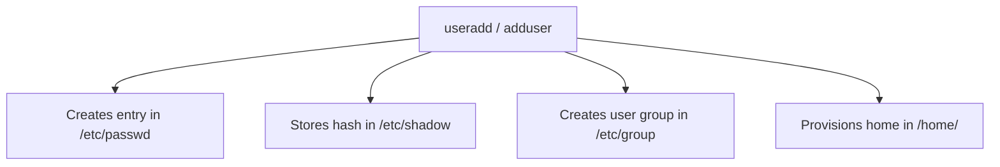
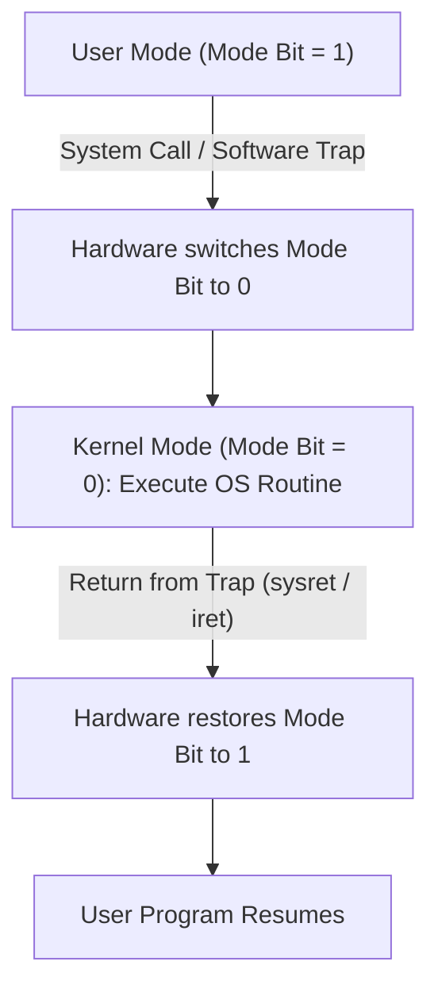
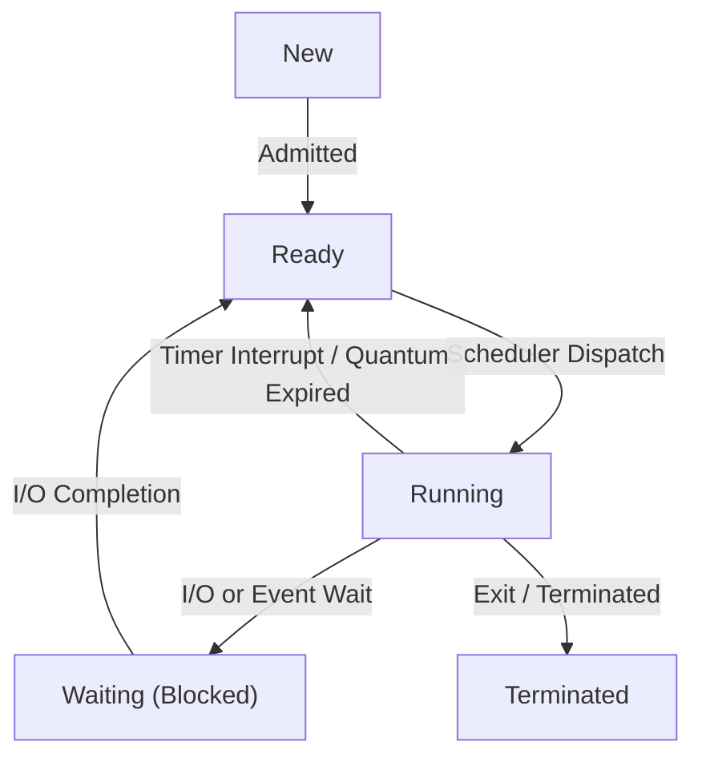
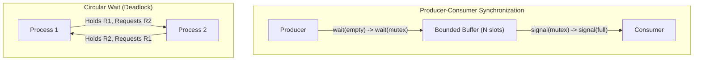
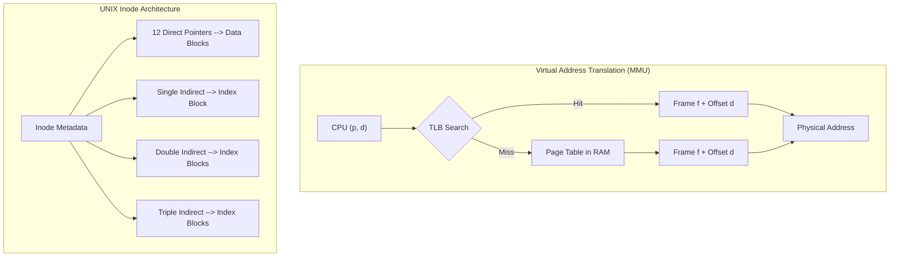

# Operating Systems — 260 Viva 1-Mark Questions with Answers

**Degree:** B.Tech CSE (Semester 3) — SRMIST  
**Course:** 21CSC204T (Theory) & 21CSC202J (Operating Systems Lab)  
**Style:** Crisp 1-mark viva flash notes (concept, keywords, code commands, math formulas)

---

## Quick Navigation
- [[#Core Formulas Cheat Sheet|Core Formulas Cheat Sheet]]
- [[#Section 1: Linux CLI, User Administration & Lab Practicals (Q1–Q60)|Section 1: Linux CLI, User Administration & Lab Practicals (Q1–Q60)]]
- [[#Section 2: Unit 1 — OS Architecture, System Calls & Booting (Q61–Q110)|Section 2: Unit 1 — OS Architecture, System Calls & Booting (Q61–Q110)]]
- [[#Section 3: Unit 2 — Processes, Schedulers, Threads & IPC (Q111–Q160)|Section 3: Unit 2 — Processes, Schedulers, Threads & IPC (Q111–Q160)]]
- [[#Section 4: Unit 3 — CPU Scheduling, Synchronization & Deadlocks (Q161–Q210)|Section 4: Unit 3 — CPU Scheduling, Synchronization & Deadlocks (Q161–Q210)]]
- [[#Section 5: Unit 4 & 5 — Memory, Paging, Disks & Security (Q211–Q260)|Section 5: Unit 4 & 5 — Memory, Paging, Disks & Security (Q211–Q260)]]
- [[#Top 15 Viva Traps & Common Mistakes|Top 15 Viva Traps & Common Mistakes]]

---

## Core Formulas Cheat Sheet

| Concept | Mathematical Formula | Meaning / Viva Key |
| :--- | :--- | :--- |
| **Turnaround Time (TAT)** | $\text{TAT} = \text{Completion Time (CT)} - \text{Arrival Time (AT)}$ | Total duration from arrival to process exit |
| **Waiting Time (WT)** | $\text{WT} = \text{Turnaround Time (TAT)} - \text{Burst Time (BT)}$ | Total duration process spent in ready queue |
| **Response Time (RT)** | $\text{RT} = \text{First CPU Execution} - \text{Arrival Time (AT)}$ | Time until first CPU response is produced |
| **Amdahl's Law Speedup** | $\text{Speedup} \le \frac{1}{S + \frac{1 - S}{N}}$ | Speedup bound on $N$ cores given serial fraction $S$ |
| **Sequential `fork()` Count** | $\text{Total} = 2^n \quad \mid \quad \text{Children} = 2^n - 1$ | Processes generated by $n$ consecutive `fork()` calls |
| **Paging Physical Address** | $\text{Address} = (f \times \text{Page Size}) + d$ | Frame number $f$ multiplied by page size plus offset $d$ |
| **TLB EMAT** | $\text{EMAT} = \alpha(\epsilon + m) + (1 - \alpha)(\epsilon + 2m)$ | Average access time with TLB hit ratio $\alpha$, TLB delay $\epsilon$, RAM delay $m$ |
| **Demand Paging EAT** | $\text{EAT} = (1 - p)m + p \times S$ | Effective access time with page fault rate $p$ and service time $S$ |
| **Banker's Need Matrix** | $\text{Need}[i][j] = \text{Max}[i][j] - \text{Allocation}[i][j]$ | Maximum remaining resource demand per process |
| **Disk Access Time** | $\text{Access Time} = \text{Seek Time} + \text{Rotational Latency} + \text{Transfer Time}$ | Mechanical seek plus track rotation plus data streaming |

---
## Section 1: Linux CLI, User Administration & Lab Practicals (Q1–Q60)
### 1.1 User & Group Administration (Q1–Q15)

**Q1: How do you create a new user account in Linux?**
- run `sudo useradd -m -s /bin/bash <username>` or interactive `sudo adduser <username>`
- `-m` creates the home directory `/home/<username>` and `-s` sets default login shell

**Q2: What is the difference between `useradd` and `adduser` in Linux?**
- `useradd`: native low-level binary; creates bare user without prompts or home directory unless flags are passed
- `adduser`: user-friendly high-level Perl script; interactively prompts for password, creates `/home` directory, and copies `/etc/skel` templates

**Q3: Which command is used to set or change a user's password?**
- run `passwd` (to change own password) or `sudo passwd <username>` (as root to set any user's password)
- updates the encrypted hash field in `/etc/shadow`

**Q4: How do you modify an existing user's attributes (e.g., shell or secondary group)?**
- run `sudo usermod [options] <username>`
- e.g., `sudo usermod -aG sudo <user>` appends user to `sudo` group, or `sudo usermod -s /bin/zsh <user>` changes shell

**Q5: How do you delete a user account along with their home directory and mail spool?**
- run `sudo userdel -r <username>`
- the `-r` flag recursively removes `/home/<username>` and `/var/mail/<username>`

**Q6: Which file stores user account information in Linux, and what is its format?**
- stored in `/etc/passwd` (world-readable, `644` permissions)
- 7 colon-separated fields: `username:password_placeholder(x):UID:GID:GECOS(full_name):home_directory:login_shell`

**Q7: What do UID 0 and UID ranges (1–999 vs 1000+) signify in Linux?**
- `UID 0`: reserved strictly for `root` (superuser)
- `UID 1–999`: system/daemon accounts (e.g., `bin`, `daemon`, `syslog`, `sshd`)
- `UID 1000+`: regular human users created on the system

**Q8: Where are group definitions stored in Linux, and what is its format?**
- stored in `/etc/group` (world-readable, `644` permissions)
- 4 colon-separated fields: `group_name:password_placeholder(x):GID:user_list`

**Q9: Which commands create and delete groups in Linux?**
- `sudo groupadd <groupname>` creates a new group entry in `/etc/group`
- `sudo groupdel <groupname>` removes the group from `/etc/group`

**Q10: How do you check which groups the current user belongs to?**
- run `groups` or `id`
- `id` prints user UID, primary GID, and all supplemental group IDs

**Q11: What does the `su` command do, and how does `su -` differ?**
- `su <user>`: switches to target user but keeps caller's current environment variables and working directory
- `su - <user>`: full login shell; loads target user's environment (`.bash_profile`, `PATH`, `HOME`)

**Q12: What does the `sudo` command do, and which file configures it?**
- executes a single command with superuser (`root`) security privileges
- configured in `/etc/sudoers` (must only be edited using `sudo visudo` to prevent syntax lockouts)

**Q13: What is the `setuid` (SUID) bit, and why is it needed on `/usr/bin/passwd`?**
- special permission bit (`4000`, displayed as `s` in owner execute position)
- executes the binary with the file owner's privileges (`root`) so regular users can write their new hash into root-only `/etc/shadow`

**Q14: What is the `setgid` (SGID) bit on directories?**
- special permission bit (`2000`, displayed as `s` in group execute position)
- files newly created inside an SGID directory automatically inherit the directory's group ownership instead of the creator's primary group

**Q15: What is the `sticky bit`, and where is it commonly used in Linux?**
- special permission bit (`1000`, displayed as `t` in others execute position)
- applied to shared writable directories like `/tmp`; prevents users from deleting or renaming files owned by others

**Q16: Where are encrypted user password hashes stored in UNIX/Linux?**
- in the `/etc/shadow` file
- readable only by `root` (permissions `000` or `640`) to prevent unauthorized users from viewing hashes

**Q17: Why were password hashes moved from `/etc/passwd` to `/etc/shadow`?**
- `/etc/passwd` must be world-readable so tools like `ls -l` can map UIDs to usernames
- leaving password hashes in `/etc/passwd` exposed them to offline dictionary and rainbow table cracking attacks

**Q18: What are the fields in an `/etc/shadow` entry?**
- 9 colon-separated fields: `username:hash:last_change:min_days:max_days:warn_days:inactive_days:expire_date:reserved`
- e.g., `alice:$6$saltsalt$hashedvalue...:19500:0:90:7:::`

**Q19: How do you identify the hash algorithm used from an `/etc/shadow` entry?**
- by the prefix number between the first dollar signs `$id$`:
- `$1$` = MD5, `$2a$` = Blowfish, `$5$` = SHA-256, `$6$` = SHA-512, `$y$` = yescrypt

**Q20: What is a Salt in password hashing, and why is it essential?**
- a random string prepended/appended to the plaintext password before passing it to the hash function
- ensures two users with identical passwords produce completely different hashes, thwarting precomputed rainbow table attacks

**Q21: Is a user's password ever decrypted by the Linux OS during login verification?**
- **No.** Cryptographic hash functions are strictly one-way ($H(m)$ cannot be reversed)
- OS reads the salt from `/etc/shadow`, hashes the user's entered password with that salt, and compares the resulting hash with the stored hash

**Q22: What mathematical properties define a secure cryptographic hash function?**
- **Pre-image resistance**: given hash $h$, infeasible to find message $m$ such that $H(m) = h$
- **Collision resistance**: infeasible to find any two distinct messages $m_1 
eq m_2$ where $H(m_1) = H(m_2)$

**Q23: What output bit lengths are produced by MD5, SHA-1, and SHA-256?**
- `MD5`: 128 bits (16 bytes, 32 hex chars)
- `SHA-1`: 160 bits (20 bytes, 40 hex chars)
- `SHA-256`: 256 bits (32 bytes, 64 hex chars)

**Q24: What does PAM stand for in Linux authentication?**
- **Pluggable Authentication Modules**
- modular architecture allowing system administrators to configure authentication mechanisms (passwords, 2FA, biometric) without recompiling applications

**Q25: How do you lock a user account without deleting it?**
- run `sudo passwd -l <username>` or `sudo usermod -L <username>`
- prepends `!` to the password hash in `/etc/shadow`, preventing password-based authentication

**Q26: What do the 10 characters in `ls -l` output represent (e.g., `-rwxr-xr--`)?**
- char 1: file type (`-` regular file, `d` directory, `l` symlink, `c` char device, `b` block device)
- chars 2–4: Owner (user `u`) permissions `rwx`
- chars 5–7: Group (`g`) permissions `rwx`
- chars 8–10: Others (`o`) permissions `rwx`

**Q27: What numeric (octal) values are assigned to read, write, and execute permissions?**
- `read (r) = 4`
- `write (w) = 2`
- `execute (x) = 1` (sum ranges from `0` = no permission to `7` = `rwx`)

**Q28: How do you set file `file.txt` permissions to `rwxr-xr--` using `chmod` in both symbolic and octal modes?**
- octal: `chmod 754 file.txt` (7 = 4+2+1, 5 = 4+1, 4 = 4)
- symbolic: `chmod u=rwx,g=rx,o=r file.txt`

**Q29: What command changes the owner and group of a file?**
- `sudo chown <user>:<group> <filename>` changes owner and group simultaneously
- `chgrp <group> <filename>` changes only the group ownership

**Q30: What is `umask`, and how does it affect default file and directory creation permissions?**
- `umask` (user file-creation mask) specifies permission bits automatically disabled when creating files or directories
- default base permissions: `666` (`rw-rw-rw-`) for regular files, `777` (`rwxrwxrwx`) for directories

**Q31: If the `umask` is `022`, what are the default permissions of a newly created file and directory?**
- new file: $666 - 022 = 644$ (`-rw-r--r--`)
- new directory: $777 - 022 = 755$ (`drwxr-xr-x`)

**Q32: Why does a directory require execute (`x`) permission?**
- execute permission on a directory allows a user to `cd` into it and access/traverse inodes within it
- read (`r`) permission only allows listing file names with `ls`

**Q33: How do you grant execute permission to user and group, while removing write from others using symbolic `chmod`?**
- run `chmod ug+x,o-w <filename>`
- combines `+` (add) and `-` (remove) directives across categories `u`, `g`, `o`

**Q34: What does `chmod -R 755 /var/www` do?**
- recursively applies `rwxr-xr-x` permissions to `/var/www` and all files/subdirectories inside it
- `-R` stands for recursive traversal

**Q35: What happens if a user has write permission on a directory but read-only permission on a file inside it?**
- the user can still delete the file from the directory
- deleting a file modifies the parent directory's data block, which requires directory write permission

**Q36: What is the difference between `pwd`, `cd`, and `cd ~`?**
- `pwd`: prints current working directory path
- `cd` or `cd ~`: navigates directly to the current user's home directory (`$HOME`)
- `cd -`: returns to previous working directory (`$OLDPWD`)

**Q37: What is the difference between `ls -l`, `ls -a`, and `ls -la`?**
- `ls -l`: long listing format showing permissions, hard link count, owner, group, size, and timestamp
- `ls -a`: lists all files including hidden dotfiles (`.` and `..`)
- `ls -la`: combines long listing with hidden files

**Q38: What is the difference between `ls -r` and `ls -R`?**
- `ls -r`: reverses sorting order (e.g., reverse alphabetical or reverse time with `-rt`)
- `ls -R`: recursively lists directory trees and all subdirectories

**Q39: How do you create a multi-level nested directory path in one command?**
- run `mkdir -p /path/to/nested/dir`
- `-p` (parents) creates missing intermediate directories without throwing an error

**Q40: What is the difference between `cp file1 file2` and `mv file1 file2`?**
- `cp`: duplicates `file1` into `file2`, creating a new inode with identical data blocks
- `mv`: renames `file1` or moves it to a new path; within the same filesystem, it simply rebinds directory entries without copying data blocks

**Q41: What command displays the first 10 lines and last 10 lines of a file?**
- `head -n 10 <file>` displays first 10 lines
- `tail -n 10 <file>` displays last 10 lines (use `tail -f <file>` to follow live log appends)

**Q42: What does `wc` command output by default, and what do `-l`, `-w`, and `-c` do?**
- default `wc <file>`: prints line count, word count, and byte count
- `wc -l`: prints only number of lines
- `wc -w`: prints only number of words
- `wc -c`: prints only number of characters/bytes

**Q43: What do the wildcards `*`, `?`, and `[a-z]` match in bash?**
- `*`: matches zero or more characters (e.g., `*.c` matches all C files)
- `?`: matches exactly one character (e.g., `test?.txt` matches `test1.txt`)
- `[a-z]`: matches any single character in the specified range or set (e.g., `[0-9]` matches any digit)

**Q44: What is the difference between a Hard Link and a Soft (Symbolic) Link?**
- **Hard link**: another directory entry pointing to the exact same inode number; shares data blocks and increments link count; cannot cross filesystems
- **Soft link (`ln -s`)**: independent file with its own inode containing the target path string; can cross filesystems and link directories; breaks if target is moved

**Q45: How do you view file contents page-by-page without loading the whole file into RAM?**
- run `less <filename>` (or legacy `more <filename>`)
- `less` allows forward/backward scrolling and searches without reading the entire file upfront

**Q46: What does the `grep` command do, and what do `-i`, `-v`, and `-n` flags mean?**
- searches text files for lines matching a specified regular expression pattern
- `-i`: case-insensitive matching
- `-v`: inverts match (prints lines that do *not* match pattern)
- `-n`: prefixes matched lines with line numbers

**Q47: What is a pipeline (`|`) in UNIX/Linux?**
- connects standard output (`stdout`, file descriptor 1) of the command on the left directly to standard input (`stdin`, file descriptor 0) of the command on the right
- e.g., `cat /etc/passwd | grep bash | wc -l` counts users with bash shells

**Q48: What is the difference between `>`, `>>`, and `<` redirection operators?**
- `>`: redirects `stdout` to a file, **overwriting** existing content
- `>>`: redirects `stdout` to a file, **appending** to existing content
- `<`: redirects `stdin` to read input from a file instead of the keyboard

**Q49: How do you redirect standard error (`stderr`) to a file in bash?**
- run `command 2> error.log` (file descriptor 2 represents `stderr`)
- run `command > out.log 2>&1` or `command &> out.log` to redirect both `stdout` and `stderr` to the same file

**Q50: What does the `tee` command do in a pipeline?**
- duplicates standard input: writes one stream to a specified file while simultaneously writing the stream to `stdout`
- e.g., `ls -l | tee file_list.txt | grep ".py"`

**Q51: What do `sort` and `uniq` commands do together?**
- `sort`: sorts lines alphabetically or numerically (`-n`)
- `uniq`: removes adjacent duplicate lines (requires input to be sorted first, e.g. `sort names.txt | uniq -c`)

**Q52: What does the `find` command do, and how do you find all `.log` files modified in the last 7 days?**
- traverses directory trees searching for files matching metadata conditions
- e.g., `find /var/log -name "*.log" -mtime -7`

**Q53: What is the difference between `ps -ef` and `ps aux`?**
- `ps -ef`: standard System V syntax displaying UID, PID, PPID, C, STIME, TTY, TIME, CMD
- `ps aux`: BSD syntax displaying USER, PID, %CPU, %MEM, VSZ, RSS, TTY, STAT, START, TIME, COMMAND

**Q54: What is the difference between `SIGTERM` (signal 15) and `SIGKILL` (signal 9)?**
- `SIGTERM (15)`: default termination request sent by `kill <pid>`; can be caught, handled, or blocked for graceful shutdown
- `SIGKILL (9)`: uncatchable, unignorable kernel kill command sent by `kill -9 <pid>`; immediately terminates the process

**Q55: How do you run a command in the background, view jobs, and bring it to the foreground?**
- append `&` to run command in background (e.g., `python3 script.py &`)
- `jobs`: lists background jobs managed by current shell
- `fg %1`: brings job number 1 back to foreground (or `Ctrl+Z` to suspend followed by `bg %1` to resume in background)

**Q56: What does the `top` command provide?**
- real-time interactive process viewer displaying CPU usage, memory utilization, load average, and active threads sorted by resource consumption

**Q57: What is the Shebang (`#!/bin/bash`) line at the start of a script?**
- absolute path interpreter directive specifying which shell/interpreter binary must execute the script file

**Q58: What do special bash variables `$0`, `$1`, `$#`, and `$?` represent?**
- `$0`: script name or invoked command
- `$1`, `$2`...: positional command-line arguments
- `$#`: total number of positional arguments passed
- `$?`: exit status of last executed command (`0` = success, non-zero = error)

**Q59: What are the core commands used in `gdb` (GNU Debugger) during OS lab debugging?**
- `gdb ./program`: loads binary compiled with `-g` debug symbols
- `break main`: sets a breakpoint at `main()`
- `run`: begins program execution; `next` steps over line; `step` steps into function
- `print <var>`: inspects variable value; `backtrace` (`bt`): displays call stack frames

**Q60: What do the C system calls `getpid()` and `getppid()` return?**
- `getpid()`: returns Process ID (PID) of calling process
- `getppid()`: returns Parent Process ID (PPID) of calling process

## Section 2: Unit 1 — OS Architecture, System Calls & Booting (Q61–Q110)
### 2.1 Dual-Mode Operation & Hardware Protection

**Q61: What is an Operating System?**
- an intermediary system software between computer hardware and user applications
- manages hardware resources (CPU, RAM, storage, I/O) and provides a secure, efficient execution environment

**Q62: What are the two primary viewpoints of an OS?**
- **User view**: designed for convenience, responsiveness, and ease of use (not resource utilization)
- **System view**: acts as a **resource allocator** (resolving conflicting requests) and a **control program** (preventing errors and illegal hardware operations)

**Q63: What is the Kernel in an Operating System?**
- the core program of the OS running continuously in memory from boot to shutdown in privileged kernel mode
- directly communicates with hardware, manages CPU scheduling, virtual memory, and device drivers

**Q64: What are the differences between Batch Systems, Multiprogramming, and Time-Sharing?**
- **Batch systems**: groups similar jobs into batches processed sequentially by an operator without user interaction
- **Multiprogramming**: keeps multiple jobs in memory simultaneously so CPU switches jobs during I/O, maximizing CPU utilization
- **Time-sharing (Multitasking)**: logical extension of multiprogramming with rapid CPU context switching (time quantum) providing interactive response times

**Q65: What is the difference between Multiprocessing (Parallel Systems) and Multiprogramming?**
- **Multiprogramming**: one single CPU executing multiple jobs concurrently by interleaving execution
- **Multiprocessing**: multiple physical CPUs/cores executing multiple instructions simultaneously in true hardware parallelism

**Q66: What is the difference between Symmetric Multiprocessing (SMP) and Asymmetric Multiprocessing (AMP)?**
- **SMP**: all processors run identical kernel copies, share common memory/bus, and are peers (no master/slave bottleneck)
- **AMP**: one master processor controls system scheduling, I/O, and assigns tasks to slave processors

**Q67: What is a Real-Time Operating System (RTOS), and how do Hard and Soft Real-Time systems differ?**
- **RTOS**: system with strict, well-defined time constraints where correctness depends on deadline fulfillment as well as logical output
- **Hard Real-Time**: missing a single deadline causes total system failure (e.g., flight autopilot, pacemaker, ABS brakes)
- **Soft Real-Time**: missing a deadline degrades quality of service but does not destroy the system (e.g., live video streaming, VR gaming)

**Q68: What are Distributed Systems (Loosely Coupled Systems)?**
- autonomous computational nodes interconnected via a network that do not share physical memory or a common clock
- communicate via message passing (RPC, sockets) to share computational resources and achieve fault tolerance

**Q69: What is a Clustered System, and how does it differ from a standard Multiprocessor?**
- composed of two or more independent individual systems (nodes) coupled together across a local network sharing common storage (SAN/NAS)
- provides high availability (fault failover) and scalable cluster parallel processing

**Q70: What is Asymmetric Clustering versus Symmetric Clustering?**
- **Asymmetric**: one machine runs active applications while other stand-by nodes monitor the server; stand-by node takes over on failure
- **Symmetric**: all nodes run applications concurrently while monitoring each other, utilizing cluster capacity fully

**Q71: What is Client-Server Computing?**
- distributed computing architecture where specialized server systems satisfy requests generated by client systems
- includes Compute-Server systems (database querying) and File-Server systems (NFS, remote web assets)

**Q72: What is Peer-to-Peer (P2P) Computing?**
- decentralized architecture where nodes act simultaneously as both clients and servers (servents)
- nodes join/leave dynamically without central coordination, discovering peers via central registry or distributed hash tables (DHT)

**Q73: What is Virtualization, and how do Type 1 and Type 2 Hypervisors differ?**
- technology allowing multiple guest operating systems to execute concurrently on isolated virtual machines on a single host
- **Type 1 (Bare-Metal)**: runs directly on host hardware without underlying OS (e.g., VMware ESXi, KVM, Xen)
- **Type 2 (Hosted)**: runs as an application process on top of a standard host OS (e.g., VirtualBox, VMware Workstation)

**Q74: What is Cloud Computing, and what are its primary service models?**
- on-demand network delivery of computing services (servers, storage, networking) over the internet
- **IaaS**: Infrastructure as a Service (raw VMs, storage)
- **PaaS**: Platform as a Service (execution runtime, databases)
- **SaaS**: Software as a Service (ready-to-use web apps)

**Q75: What is an Embedded System OS?**
- specialized, resource-constrained OS running inside dedicated appliances (car sensors, microwave, smart TV)
- often lacks virtual memory, features minimal footprint, and executes deterministic embedded real-time kernels (e.g., FreeRTOS)

**Q76: What is the Degree of Multiprogramming?**
- the total number of processes currently maintained in main memory (RAM)
- controlled strictly by the Long-Term Scheduler (admission scheduler)

**Q77: What is Spooling in early operating systems?**
- **Simultaneous Peripheral Operations On-Line**
- overlaps I/O of one job with CPU computation of another by buffering data on magnetic disk, preventing slow mechanical peripherals from blocking CPU

**Q78: Why does hardware provide Dual-Mode Operation (User Mode vs Kernel Mode)?**
- protects the OS kernel and shared hardware from errant or malicious user programs
- ensures application crashes cannot corrupt kernel memory or seize unauthorized hardware control

**Q79: How does hardware track whether the system is in User Mode or Kernel Mode?**
- via a dedicated **Mode Bit** in the CPU status register (`EFLAGS` / program status word)
- `0` = Kernel Mode (Supervisor / Privileged mode); `1` = User Mode

**Q80: What are Privileged Instructions?**
- instructions executable *only* when the CPU is running in Kernel Mode (mode bit = 0)
- e.g., disabling interrupts, direct I/O port instructions (`in`/`out`), modifying base/limit registers, setting timer counter

**Q81: What happens if a user program attempts to execute a privileged instruction in User Mode?**
- the CPU hardware immediately intercepts the instruction, blocks execution, and generates a **Trap / Hardware Exception**
- control transfers to the OS trap handler, which terminates the offending process with a segmentation fault or illegal instruction error

**Q82: How does the CPU transition from User Mode to Kernel Mode and back?**
- user to kernel: triggered by a **System Call**, **Software Trap/Exception**, or **Hardware Interrupt**; hardware automatically sets mode bit to `0`
- kernel to user: OS executes privileged return instruction (`sysret` / `iret`); hardware automatically resets mode bit to `1`

**Q83: How does the OS protect the CPU from being monopolized by an infinite user loop?**
- using a hardware **Timer** configured by the kernel to generate periodic clock interrupts (ticks)
- when the timer counter reaches zero, a timer interrupt fires, transferring control back to OS scheduler to switch processes

**Q84: How is memory protection implemented at the hardware level in contiguous allocation?**
- using **Base** and **Limit** registers
- **Base register**: holds smallest legal physical memory address of process
- **Limit register**: specifies range/size of process space; hardware checks `Base <= Address < Base + Limit` on every memory reference

**Q85: What happens when a CPU generates a memory address violating the Limit register?**
- the memory management unit (MMU) traps to the operating system with a **Segmentation Fault** / access violation exception
- OS immediately aborts the rogue process

**Q86: Why is I/O protection mandatory in modern operating systems?**
- prevents user programs from performing raw, direct reads/writes to disk, network cards, or keyboard buffers
- all I/O instructions are privileged; user applications must request I/O through authenticated OS system calls

**Q87: What is the difference between a Hardware Interrupt and a Software Trap?**
- **Hardware Interrupt**: asynchronous signal generated by external hardware devices (timer, keyboard, disk controller) via system bus
- **Software Trap (Exception)**: synchronous event generated directly by CPU executing user code (system call, divide by zero, page fault)

**Q88: What is an Interrupt Vector Table (IVT)?**
- a fixed table in low memory containing memory addresses of all Interrupt Service Routines (ISRs)
- indexed directly by the unique interrupt number/vector to jump instantly to the corresponding handler

**Q89: What steps occur when a CPU receives an interrupt?**
- CPU finishes current instruction, saves Program Counter (PC) and CPU registers onto kernel stack
- looks up interrupt vector in IVT, switches to kernel mode (mode bit = 0), and executes ISR
- restores saved registers and executes `iret` to resume interrupted program

**Q90: What is Interrupt Latency?**
- the total time elapsed from the moment a hardware device asserts an interrupt line until the first instruction of the ISR begins execution

**Q91: What is Direct Memory Access (DMA), and why is it used?**
- special hardware controller that transfers blocks of data directly between high-speed I/O devices (disks, NICs) and main memory without CPU intervention
- generates only one single interrupt per block transfer instead of one interrupt per byte, drastically reducing CPU overhead

**Q92: List the Memory Hierarchy from fastest/smallest to slowest/largest.**
- Registers -> Cache (L1, L2, L3) -> Main Memory (RAM) -> Solid State Drive (SSD) -> Hard Disk (HDD) -> Optical / Magnetic Tape
- access speed and cost per bit decrease while capacity increases down the hierarchy

**Q93: What is Cache Coherency in multiprocessor systems?**
- hardware protocol ensuring that if a CPU core updates a shared variable in its local L1/L2 cache, all other cores see the updated copy immediately
- prevents stale data reads across parallel execution units

**Q94: What is a System Call?**
- programmatic interface through which a user application requests privileged services from the operating system kernel
- triggers a software trap that switches CPU execution from user mode to kernel mode

**Q95: What are the 5 major categories of System Calls with examples?**
- **Process Control**: `fork()`, `exec()`, `wait()`, `exit()`
- **File Management**: `open()`, `read()`, `write()`, `close()`
- **Device Management**: `ioctl()`, `read()`, `write()`
- **Information Maintenance**: `getpid()`, `alarm()`, `time()`
- **Communication**: `pipe()`, `shmget()`, `socket()`

**Q96: Why do application developers use Standard APIs (POSIX, Win32) instead of raw system calls?**
- **Portability**: applications run across compliant OS versions without binary rewrites
- **Simplicity**: high-level library functions (like `printf()`, `malloc()`) handle argument validation, buffer formatting, and error mapping

**Q97: What are the three general methods used to pass parameters to system calls?**
- **CPU Registers**: fastest method; passes arguments directly in hardware registers (limited by register count)
- **Memory Block / Table**: parameters stored in a memory block, and address pointer to block is passed in a register
- **Stack**: parameters pushed onto program stack by application and popped off by OS kernel

**Q98: What is a System Call Table?**
- an internal kernel array mapping unique system call numbers (e.g., `sys_read = 0`, `sys_write = 1` on x86_64) to corresponding kernel function pointers

**Q99: What is the difference between synchronous and asynchronous I/O system calls?**
- **Synchronous**: caller process blocks and enters waiting state until I/O operation completes and data is transferred
- **Asynchronous**: system call returns immediately to caller; process continues execution while I/O proceeds concurrently; notified via signal/callback

**Q100: What is the role of the C Standard Library runtime wrapper for system calls?**
- places system call number in register (e.g. `RAX`), loads arguments into designated registers (`RDI`, `RSI`, `RDX`), executes `syscall` instruction, and handles return errno

**Q101: What does `strace` utility do in Linux?**
- diagnostic CLI tool that intercepts, logs, and displays all system calls made by a process and signals received during runtime

**Q102: What is the difference between a Monolithic Kernel and a Microkernel?**
- **Monolithic**: all OS services (VFS, IPC, drivers, scheduler, network stack) run in single address space in kernel mode; high performance, large attack surface
- **Microkernel**: moves non-essential services into user-space daemons, leaving only core IPC, virtual memory, and scheduling in kernel mode; highly reliable, IPC message overhead

**Q103: What are the advantages and drawbacks of a Microkernel architecture (e.g., Mach, QNX)?**
- **Advantages**: modular, easier to extend, highly crash-resilient (crashed driver doesn't crash kernel)
- **Drawback**: performance penalty caused by frequent user-to-kernel context switches and IPC message passing

**Q104: What is the Layered Approach in operating system design?**
- OS structured into a hierarchy of discrete layers ($N$ to $0$); layer $0$ is hardware and layer $N$ is user interface
- each layer invokes services only of underlying layers; modular and easy to debug, but difficult to define strict layering boundaries efficiently

**Q105: What are Loadable Kernel Modules (LKMs) in Linux?**
- dynamically linked object files (`.ko`) inserted into or removed from the running kernel without rebooting
- provides monolithic performance with microkernel modularity (used for hardware device drivers and filesystems)

**Q106: What is a Hybrid Kernel architecture?**
- combines monolithic performance with microkernel modularity
- e.g., macOS (XNU kernel combining Mach microkernel IPC with FreeBSD monolithic VFS/networking) and Windows NT

**Q107: What is the difference between BIOS and UEFI firmware?**
- **BIOS**: legacy 16-bit firmware executing in real mode; reads Master Boot Record (MBR) limited to 2 TB drives
- **UEFI**: modern 32/64-bit firmware with graphical interface, mouse support, Secure Boot validation, and native GUID Partition Table (GPT) support

**Q108: What is the difference between MBR and GPT partitioning schemes?**
- **MBR (Master Boot Record)**: located in sector 0 (512 bytes); limited to 4 primary partitions and 2.2 TB disk capacity
- **GPT (GUID Partition Table)**: uses 64-bit logical block addressing, supports disks up to 9.4 ZB, allows up to 128 partitions, and includes backup CRC headers

**Q109: Explain the complete Linux Booting Sequence step-by-step.**
- **Power On / POST**: firmware checks hardware integrity
- **Firmware**: BIOS/UEFI loads bootloader from MBR/EFI System Partition
- **Bootloader (GRUB)**: loads compressed kernel (`vmlinuz`) and initial RAM disk (`initrd` / `initramfs`)
- **Kernel Initialization**: probes hardware, mounts root filesystem (`/`), and launches PID 1 (`/sbin/init` or `systemd`)

**Q110: What is the role of PID 1 (`systemd` / `init`) in Linux?**
- first user-space process spawned directly by the kernel
- ancestor of all processes; manages system service daemons, mounts filesystems, and automatically adopts and reaps orphan processes

## Section 3: Unit 2 — Processes, Schedulers, Threads & IPC (Q111–Q160)
### 3.1 Process Lifecycle & Multithreading Architecture

**Q111: What is a Process?**
- a program in execution
- an active entity with a Program Counter, CPU registers, stack, data section, and allocated system resources (unlike a passive program file on disk)

**Q112: What are the components of a process's memory layout?**
- **Text section**: compiled executable machine code
- **Data section**: initialized global and static variables
- **BSS section**: uninitialized global and static variables
- **Heap**: dynamically allocated memory at runtime via `malloc()` / `new` (grows upward)
- **Stack**: local variables, function parameters, and return addresses (grows downward)

**Q113: What are the 5 core states of a process?**
- **New**: process being created
- **Ready**: loaded in RAM waiting for CPU allocation
- **Running**: instructions currently executing on CPU
- **Waiting (Blocked)**: waiting for external I/O completion or signal
- **Terminated**: finished execution; OS reclaiming resources

**Q114: What is a Process Control Block (PCB / Task Control Block)?**
- a fundamental kernel data structure representing a process
- contains all metadata needed to suspend and resume the process deterministically

**Q115: What key fields are stored inside a PCB?**
- **Process State**: current state (ready, running, waiting)
- **Process ID (PID)** and Parent PID (PPID)
- **Program Counter (PC)**: address of next instruction to execute
- **CPU Registers**: accumulators, index registers, stack pointers
- **CPU Scheduling Info**: process priority, queue pointers
- **Memory Management Info**: page tables, segment tables, base/limit registers
- **Accounting Info**: CPU time used, limits
- **I/O Status Info**: list of open file descriptors and allocated devices

**Q116: What is Context Switching in an OS?**
- saving the hardware context (registers, PC) of the currently running process into its PCB and loading the saved context of another process from its PCB
- represents pure computational overhead because the CPU performs no useful application work during the switch

**Q117: What factors determine context switch overhead?**
- CPU hardware architecture, number of registers to save/restore, memory speed, and TLB cache invalidation/flushing

**Q118: What is the difference between an I/O-bound process and a CPU-bound process?**
- **I/O-bound process**: spends majority of time performing I/O; characterized by many short CPU bursts (e.g., text editor, web browser)
- **CPU-bound process**: spends majority of time performing mathematical computations; characterized by few, very long CPU bursts (e.g., video rendering, scientific matrix simulations)

**Q119: What are the three primary process scheduling queues?**
- **Job Queue**: contains all processes submitted to the system residing on disk
- **Ready Queue**: set of all processes residing in main memory ready and waiting to execute on CPU
- **Device Queue**: list of processes waiting for a specific I/O device controller

**Q120: What are the roles of Long-Term, Short-Term, and Medium-Term Schedulers?**
- **Long-Term Scheduler (Job Scheduler)**: selects jobs from disk pool and loads them into memory; controls Degree of Multiprogramming (executes infrequently)
- **Short-Term Scheduler (CPU Scheduler)**: selects which in-memory ready process gets the CPU next; executes ultra-frequently (e.g., every 10–100ms)
- **Medium-Term Scheduler (Swapper)**: temporarily removes processes from memory to disk (swapping out) during memory pressure and reintroduces them later (swapping in)

**Q121: Why must the Long-Term Scheduler maintain a balanced mix of I/O-bound and CPU-bound processes?**
- if all processes are I/O-bound, the ready queue is empty and the CPU sits idle
- if all processes are CPU-bound, I/O devices sit idle and device queues remain empty

**Q122: What is Preemptive vs Non-Preemptive scheduling?**
- **Preemptive**: OS kernel can forcibly interrupt a running process and reallocate CPU to another process (e.g., timer interrupt or higher-priority arrival)
- **Non-Preemptive (Cooperative)**: running process retains CPU until it voluntarily terminates or invokes an I/O block

**Q123: What are the 4 circumstances under which CPU scheduling decisions take place?**
- 1. Process switches from running to waiting state (e.g., I/O request) — *Non-preemptive*
- 2. Process switches from running to ready state (e.g., timer interrupt) — *Preemptive*
- 3. Process switches from waiting to ready state (e.g., I/O completed) — *Preemptive*
- 4. Process terminates — *Non-preemptive*

**Q124: What is the Dispatcher in CPU scheduling, and what is Dispatch Latency?**
- module that gives control of the CPU to the process selected by the short-term scheduler (performs context switch, switches to user mode, jumps to proper PC location)
- **Dispatch Latency**: time required for the dispatcher to stop one process and start another running

**Q125: What does the `fork()` system call do in UNIX/Linux?**
- creates a brand-new child process by making an exact duplicate of the parent's address space
- returns `0` to the child process, returns child's `PID` to the parent process, and returns `-1` on error

**Q126: How many total processes and child processes are created by $n$ consecutive `fork()` calls?**
- **Total processes** = $2^n$
- **Child processes created** = $2^n - 1$
- e.g., 3 sequential `fork()` calls create $2^3 = 8$ total processes and 7 child processes

**Q127: What is Copy-on-Write (COW) during process creation?**
- memory optimization where parent and child initially share identical physical memory pages marked read-only
- a page is duplicated only when either process attempts to modify/write to that page, eliminating unnecessary memory copying on `fork()`

**Q128: What does the `exec()` family of system calls do?**
- replaces the calling process's current memory image, text, data, heap, and stack completely with a new binary executable program
- PID remains identical, but execution begins at the `main()` entry of the new program

**Q129: What is the standard UNIX pattern for running a new program?**
- the parent calls `fork()` to spawn a child process
- child calls `exec()` to load and execute the target binary
- parent calls `wait()` to suspend itself until the child finishes and retrieve its exit status

**Q130: What does the `wait(&status)` system call do?**
- blocks calling parent process until one of its child processes terminates
- returns the PID of the terminated child and writes its termination exit code into `status`

**Q131: What does `exit(int status)` do?**
- terminates the calling process immediately, closes open file descriptors, flushes buffers, and returns integer exit status (0–255) to the OS kernel

**Q132: What is the difference between `_exit()` and `exit()` in C?**
- `exit()`: C standard library function that calls registered `atexit()` handlers, flushes user-space I/O streams (`fflush`), and then invokes kernel exit
- `_exit()`: raw kernel system call that immediately terminates the process without flushing C stdio buffers

**Q133: What is a Zombie Process in Linux?**
- a process that has completed execution via `exit()`, but still possesses an entry in the process table because its parent has not yet called `wait()` to read its exit status
- appears as status `Z` or `<defunct>` in `ps` output

**Q134: Does a zombie process consume CPU or RAM?**
- **No.** It consumes zero CPU and zero memory; it retains only a minimal 32-bit entry in the kernel process table to preserve its exit code

**Q135: What happens if a system accumulates too many zombie processes?**
- it exhausts available Process IDs (`PID max`), preventing the operating system from creating any new processes

**Q136: How do you eliminate/kill a zombie process?**
- a zombie cannot be killed with `kill -9` because it is already dead
- kill its **parent process**; when parent dies, the zombie is adopted by PID 1 (`init` / `systemd`), which immediately issues `wait()` and reaps it

**Q137: What is an Orphan Process in Linux?**
- an actively executing process whose parent process terminated before calling `wait()`
- automatically adopted by PID 1 (`systemd` / `init`), which periodically reaps terminated children

**Q138: What is a Daemon Process?**
- a long-running background service process detached from any controlling terminal (TTY)
- typically ends with `d` (e.g., `sshd`, `cron`, `systemd`) and handles recurring system tasks

**Q139: Why do cooperating processes require Inter-Process Communication (IPC)?**
- to share information, modularize system tasks, speed up computation via parallel execution, and synchronize actions

**Q140: What are the two fundamental models of IPC?**
- **Shared Memory**: processes map a common region of physical memory into their respective address spaces; fastest IPC method because data access occurs at RAM speed without kernel intervention
- **Message Passing**: communication occurs through kernel mediation via explicit `send()` and `receive()` system calls; useful for small messages across distributed networks

**Q141: What are the advantages and trade-offs of Shared Memory vs Message Passing?**
- **Shared Memory**: zero kernel overhead during read/write; however, applications must explicitly handle synchronization (mutexes/semaphores) to prevent race conditions
- **Message Passing**: kernel handles synchronization and buffer management automatically; however, requires expensive user-to-kernel mode switches and data copying for every message

**Q142: What is the difference between Direct and Indirect Communication in message passing?**
- **Direct**: sender and receiver must explicitly name each other: `send(P, message)` and `receive(Q, message)`
- **Indirect**: messages sent to and received from shared mailboxes or message ports: `send(mailbox_A, message)` and `receive(mailbox_A, message)`

**Q143: What is the difference between Blocking (Synchronous) and Non-Blocking (Asynchronous) IPC primitives?**
- **Blocking Send**: sending process suspends until message is received by receiver or mailbox
- **Non-Blocking Send**: sending process transmits message and immediately resumes execution
- **Blocking Receive**: receiver suspends until a message is available
- **Non-Blocking Receive**: receiver retrieves either a valid message or an immediate `null` indication

**Q144: What is a Rendezvous in IPC message passing?**
- when both `send()` and `receive()` primitives are blocking
- sender and receiver synchronize at a specific point in time before data transfer proceeds

**Q145: What are the three buffering capacities available for message queues?**
- **Zero capacity**: queue length = 0; link cannot hold messages; sender must block until recipient receives (rendezvous)
- **Bounded capacity**: finite queue length $n$; sender blocks only if queue is full
- **Unbounded capacity**: infinite queue length; sender never blocks

**Q146: What is an Anonymous Pipe vs a Named Pipe (FIFO) in UNIX?**
- **Anonymous Pipe (`pipe()`)**: unidirectional byte stream communication channel between related parent-child processes; ceases to exist when file descriptors are closed
- **Named Pipe (`mkfifo`)**: appears as a special FIFO file in the filesystem; persists across reboots and allows bidirectional communication between completely unrelated processes

**Q147: What is a Thread (Lightweight Process - LWP)?**
- the smallest unit of CPU execution within a process
- possesses its own thread ID, program counter (PC), register set, and stack

**Q148: What components do threads belonging to the same process share?**
- share the code section (text), data section (globals), heap (dynamic memory), and open OS resources (file descriptors, signals)

**Q149: What are the primary benefits of Multithreading over Multiprocessing?**
- **Responsiveness**: background threads handle heavy operations while UI thread remains responsive
- **Resource Sharing**: threads share memory by default without expensive IPC setup
- **Economy**: thread creation and context switching are 10–30x cheaper than full process creation
- **Scalability**: threads can execute concurrently across multiple physical CPU cores

**Q150: What is the difference between Concurrency and Parallelism?**
- **Concurrency**: managing multiple tasks making progress over overlapping time periods (can occur on a single-core CPU via rapid context interleaving)
- **Parallelism**: executing multiple computational tasks at the exact same physical instant (requires multi-core/multiprocessor hardware)

**Q151: What are User-Level Threads (ULT) vs Kernel-Level Threads (KLT)?**
- **User-Level**: managed entirely by user-space thread library without kernel awareness; ultra-fast context switching; drawback: if one thread makes a blocking system call, the entire process blocks
- **Kernel-Level**: managed and scheduled directly by the OS kernel; true multi-core parallel execution; drawback: context switching requires kernel mode switch overhead

**Q152: What is the Many-to-One Multithreading Model?**
- maps many user-level threads to one single kernel thread
- advantages: fast thread management in user space; disadvantage: entire process blocks if one thread blocks; no true multi-core parallelism

**Q153: What is the One-to-One Multithreading Model (used in Linux & Windows)?**
- maps each user thread directly to a dedicated kernel thread
- advantages: allows other threads to run when one blocks; enables true hardware parallelism on multi-core systems; disadvantage: creating a user thread incurs kernel thread creation overhead

**Q154: What is the Many-to-Many Multithreading Model?**
- multiplexes many user-level threads to a smaller or equal number of kernel threads
- provides concurrency without saturating the kernel with excessive thread allocations; complex to implement

**Q155: What does Amdahl's Law state, and what is its mathematical formula?**
- calculates theoretical speedup improvement when executing an application on $N$ processor cores given serial proportion $S$:
- $$\text{Speedup} \le \frac{1}{S + \frac{1 - S}{N}}$$
- shows that maximum achievable speedup is strictly bounded by $\frac{1}{S}$ regardless of how many cores ($N \to \infty$) are added

**Q156: If an application has 25% serial code ($S = 0.25$), what is the maximum possible speedup with infinite cores?**
- as $N \to \infty$, $\text{Speedup} \le \frac{1}{0.25} = 4\times$
- even with 10,000 CPU cores, the application will never run faster than 4 times its original speed

**Q157: What is a Thread Pool, and why is it used?**
- a pre-allocated pool of worker threads created at startup waiting for work items in a queue
- avoids latency of repeatedly creating/destroying threads per request, and bounds maximum concurrent threads to prevent resource exhaustion

**Q158: What is Thread-Local Storage (TLS)?**
- a dedicated storage mechanism allowing each thread to possess its own private copy of static or global variables
- useful when threads execute shared library functions requiring state retention without race conditions

**Q159: What happens if one thread in a multithreaded process calls `fork()` in POSIX?**
- some UNIX systems duplicate all threads, while others duplicate only the calling thread
- POSIX specifies that `fork()` duplicates *only the calling thread* in the child process

**Q160: What is the POSIX Pthreads standard?**
- IEEE standard (POSIX 1003.1c) defining API specification for thread creation and synchronization (`pthread_create`, `pthread_join`, `pthread_mutex_lock`)
- it is a specification, not an implementation; Linux implements it via the native NPTL (Native POSIX Thread Library)

## Section 4: Unit 3 — CPU Scheduling, Synchronization & Deadlocks (Q161–Q210)
### 4.1 Bounded Buffer & Deadlock Resource Allocation Flow

**Q161: What are the 5 core CPU Scheduling Criteria?**
- **CPU Utilization**: percentage of time CPU is actively executing tasks (target: 40%–90%)
- **Throughput**: number of completed processes per unit time
- **Turnaround Time (TAT)**: total elapsed time from process submission to completion
- **Waiting Time (WT)**: total time spent waiting in the ready queue
- **Response Time (RT)**: time elapsed from submission until first CPU response is produced

**Q162: What are the exact mathematical formulas for Turnaround Time and Waiting Time?**
- $$\text{TAT} = \text{Completion Time (CT)} - \text{Arrival Time (AT)}$$
- $$\text{Waiting Time (WT)} = \text{Turnaround Time (TAT)} - \text{Burst Time (BT)}$$

**Q163: What is Response Time, and why is it preferred over Turnaround Time in interactive systems?**
- $$\text{RT} = \text{Time of First CPU Execution} - \text{Arrival Time (AT)}$$
- in interactive GUI/web systems, users perceive responsiveness based on how quickly the system acknowledges input, even if total task duration is long

**Q164: What is the CPU-I/O Burst Cycle?**
- execution profile of processes alternating between active computational bursts on the CPU and waiting bursts for I/O completion
- a typical process begins with a CPU burst, followed by an I/O burst, and eventually concludes on a CPU burst

**Q165: What is the Convoy Effect in CPU scheduling, and which algorithm causes it?**
- situation where a long CPU-intensive process monopolizes the CPU, forcing many short I/O-bound processes to wait behind it in the ready queue
- caused by non-preemptive **First-Come, First-Served (FCFS)** scheduling; results in poor CPU and device utilization

**Q166: Why is Shortest Job First (SJF) provably optimal for minimizing average waiting time?**
- by scheduling the process with the shortest burst time first, it decreases the waiting time for all subsequent processes more than any other ordering
- mathematical property: moves shorter jobs ahead, minimizing the prefix sum of waiting times

**Q167: What is the primary drawback of Shortest Job First (SJF) in practical systems?**
- **Unattainable burst time**: the OS cannot know the exact length of the next CPU burst in advance
- **Starvation**: continuous arrival of short jobs can indefinitely postpone execution of long processes

**Q168: How can the OS predict the next CPU burst length for SJF scheduling?**
- using **Exponential Moving Average (Smoothing)** of historical burst lengths:
- $$\tau_{n+1} = \alpha t_n + (1 - \alpha) \tau_n$$
- where $t_n$ is actual length of $n$-th burst, $\tau_n$ is predicted history, and $\alpha \in [0, 1]$ is weighting factor

**Q169: What is Shortest Remaining Time First (SRTF)?**
- the **preemptive version of SJF**
- if a newly arriving process has a remaining CPU burst shorter than the currently executing process, the CPU is preempted and allocated to the new process

**Q170: How does Round Robin (RR) scheduling operate?**
- allocates CPU to ready processes in cyclic FIFO order for a fixed, small interval of time called a **Time Quantum** (slice, typically 10–100ms)
- when quantum expires, a timer interrupt fires, process is preempted and appended to the tail of the ready queue

**Q171: What happens if the Round Robin Time Quantum is set extremely large or extremely small?**
- **Too large ($q \to \infty$)**: RR degenerates into simple First-Come, First-Served (FCFS) with convoy effect
- **Too small ($q \to 0$)**: causes excessive context switching; CPU spends majority of time swapping registers rather than executing instructions

**Q172: What rule of thumb governs Time Quantum selection in Round Robin?**
- **80% rule**: approximately 80% of CPU bursts should be shorter than the time quantum $q$ to balance responsiveness and context switch overhead

**Q173: What is Priority Scheduling, and what is its major failure mode?**
- allocates CPU to the process with the highest priority (conventionally, smallest integer = highest priority)
- **Starvation (Indefinite Blocking)**: low-priority processes may wait forever if higher-priority processes continuously arrive

**Q174: How is starvation in Priority Scheduling resolved?**
- using **Aging**: technique that gradually increases the priority of processes that have been waiting in the ready queue for prolonged periods

**Q175: What is a Multilevel Queue (MLQ) scheduling system?**
- partitions the ready queue into several separate queues based on process type (e.g., foreground interactive queue vs background batch queue)
- each queue has its own scheduling algorithm, and processes are permanently assigned to one queue with fixed priority preemptive scheduling across queues

**Q176: What is a Multilevel Feedback Queue (MLFQ) scheduler?**
- allows processes to dynamically **move between queues** based on their runtime CPU burst behavior
- CPU-intensive processes sink to lower-priority queues with larger quanta; I/O-bound interactive processes rise to high-priority queues with short quanta

**Q177: What is a Race Condition?**
- a scenario where multiple concurrent threads/processes access and manipulate shared data simultaneously
- the final outcome depends unpredictably on the exact order of execution and thread interleaving

**Q178: What is the Critical Section in a program?**
- a segment of code where a process accesses and modifies shared variables, writes to shared files, or updates shared hardware tables
- must be executed with mutual exclusion to prevent data inconsistency

**Q179: What 3 requirements must any valid solution to the Critical Section problem satisfy?**
- **1. Mutual Exclusion**: if process $P_i$ is executing in its critical section, no other processes can be executing in their critical sections
- **2. Progress**: if no process is in its critical section and some wish to enter, only processes not in their remainder section can participate in deciding who enters next, and selection cannot be postponed indefinitely
- **3. Bounded Waiting**: there must be a bound/limit on the number of times other processes are allowed to enter their critical sections after a process has made a request to enter

**Q180: What is the difference between a Preemptive Kernel and a Non-Preemptive Kernel regarding race conditions?**
- **Preemptive Kernel**: allows a process to be preempted while running in kernel mode; more responsive, but requires explicit kernel synchronization on shared data
- **Non-Preemptive Kernel**: kernel process runs until it voluntarily yields, blocks, or exits; inherently free of race conditions on single-core CPUs

**Q181: What is Peterson's Solution, and what shared variables does it utilize?**
- classic software-based solution to the critical section problem for **2 processes** ($P_0$ and $P_1$)
- uses two shared variables: `int turn` (indicates whose turn it is) and `boolean flag[2]` (indicates if a process is ready to enter)

**Q182: Show the entry and exit code for process $P_i$ in Peterson's Solution.**
- entry: `flag[i] = true; turn = j; while (flag[j] && turn == j);`
- exit: `flag[i] = false;`

**Q183: Why is Peterson's Solution not guaranteed to work on modern multicore CPUs without memory barriers?**
- modern out-of-order processors and optimizing compilers reorder memory reads and writes (`load`/`store` reordering) for performance, breaking software synchronization assumptions without explicit memory fences

**Q184: What are the two standard hardware instructions used to achieve synchronization?**
- **`TestAndSet(&target)`**: atomically reads original boolean value and sets `target` to `true`
- **`Swap(&a, &b)` / `CompareAndSwap`**: atomically swaps the contents of two words or compares memory with expected value before updating

**Q185: What makes hardware synchronization instructions atomic?**
- executed as a single, uninterruptible hardware bus transaction; no other processor core or interrupt can modify memory mid-instruction

**Q186: What is a Spinlock?**
- a lock where a thread trying to acquire it enters a tight busy-waiting loop (`while(locked);`) repeatedly checking lock availability
- ideal when critical sections are ultra-short because it avoids expensive thread context switch and sleep overhead; wastes CPU cycles if held long

**Q187: What is a Mutex Lock?**
- **Mutual Exclusion Lock**: binary flag with explicit ownership (`lock()` and `unlock()`)
- a thread acquiring the lock enters critical section; only the thread that locked the mutex is permitted to unlock it

**Q188: What is Priority Inversion, and how does Priority Inheritance solve it?**
- **Priority Inversion**: high-priority process $H$ is indirectly blocked by low-priority process $L$ holding a lock that medium process $M$ preempts
- **Priority Inheritance**: temporarily elevates $L$'s priority to $H$'s priority until $L$ releases the contested lock, preventing $M$ from preempting

**Q189: What is a Semaphore, and what are its two atomic operations?**
- synchronization variable initialized to an integer value, manipulated *only* through two standard atomic operations:
- **`wait()` (or `P()` / `down()` / `sem_wait()`)**: decrements value; if value $< 0$, calling process blocks
- **`signal()` (or `V()` / `up()` / `sem_post()`)**: increments value; if value $\le 0$, wakes up one blocked process

**Q190: What is the difference between a Counting Semaphore and a Binary Semaphore?**
- **Binary Semaphore**: integer value restricted strictly to `0` or `1` (acts functionally like a mutex without ownership checks)
- **Counting Semaphore**: integer value unrestricted ($0$ to $N$); used to control resource access with a finite number of identical instances

**Q191: What does it mean if a Semaphore's value is negative?**
- in standard implementation, a negative value like $-k$ indicates that exactly $k$ processes are currently suspended waiting in the semaphore queue

**Q192: Why are semaphores prone to programming bugs?**
- omitting a `wait()` or `signal()`, swapping order (`signal()` before `wait()`), or double-calling operations causes deadlocks or mutual exclusion breaches

**Q193: What is a Monitor in process synchronization?**
- a high-level programming language construct (ADT) encapsulating shared data variables and procedures
- compiler automatically enforces that only **one process at a time can be active inside the monitor**

**Q194: What are Condition Variables in a Monitor?**
- synchronization objects within monitors allowing threads to suspend and resume:
- `x.wait()`: calling process suspends until another process invokes `x.signal()`
- `x.signal()`: resumes exactly one process waiting on condition variable `x` (no-op if none waiting, unlike semaphores)

**Q195: What is the difference between Hoare (Signal-and-Wait) and Mesa (Signal-and-Continue) monitor semantics?**
- **Hoare (Signal-and-Wait)**: signaler process yields control immediately and waits; awakened process executes inside monitor instantly
- **Mesa (Signal-and-Continue)**: signaler continues executing; awakened process moves to entry queue and must re-check condition (`while(!cond) wait()`)

**Q196: Why is `while` loop re-evaluation mandatory for condition variables under Mesa semantics (Java, POSIX)?**
- because between the time a thread is signaled and the time it gets CPU to enter the monitor, another thread might have slipped in and invalidated the condition

**Q197: Explain the Producer-Consumer Problem and what semaphores are used.**
- producer generates data items into a bounded buffer of size $N$; consumer extracts items
- requires 3 semaphores:
- `mutex = 1` (mutual exclusion for buffer access)
- `empty = N` (counts available empty slots; initialized to $N$)
- `full = 0` (counts filled slots; initialized to $0$)

**Q198: Why does the Producer call `wait(empty)` before `wait(mutex)` in Bounded Buffer?**
- reversing to `wait(mutex)` then `wait(empty)` causes **Deadlock**: if buffer is full, producer locks mutex, blocks on empty, and consumer can never acquire mutex to consume!

**Q199: Explain the First Readers-Writers Problem (Reader Preference).**
- multiple readers can read concurrently; writers require exclusive access
- uses `mutex = 1` (protects `readcount`), `rw_mutex = 1` (protects data access), and integer `readcount`
- if readers continuously arrive, incoming writers suffer **starvation**

**Q200: In Readers-Writers, what code executes when the first reader arrives and the last reader leaves?**
- first reader (`readcount == 1`): executes `wait(rw_mutex)` to lock out writers
- last reader (`readcount == 0`): executes `signal(rw_mutex)` to allow waiting writers to proceed

**Q201: Explain the Dining Philosophers Problem and why deadlock occurs.**
- 5 philosophers sit around a circular table with 5 bowls and 5 chopsticks (semaphores)
- to eat, a philosopher needs both adjacent left and right chopsticks
- **Deadlock**: if all 5 philosophers become hungry simultaneously and pick up their left chopstick, all right chopsticks are occupied and every philosopher blocks forever

**Q202: List 3 distinct strategies to prevent deadlock in Dining Philosophers.**
- **1. Asymmetric**: odd philosophers pick left then right; even philosophers pick right then left
- **2. Capacity Limiting**: allow at most 4 philosophers to sit at the 5-seat table simultaneously
- **3. Atomic acquisition**: pick up both chopsticks simultaneously only if both are currently free (using monitor)

**Q203: What is a Deadlock in an operating system?**
- a situation where a set of processes are blocked because every process is holding resources while waiting for another resource held by another process in the same set

**Q204: What are the 4 Coffman Conditions necessary and sufficient for a deadlock to arise?**
- **1. Mutual Exclusion**: at least one non-shareable resource held in exclusive mode
- **2. Hold and Wait**: process must be holding at least one resource while waiting to acquire additional resources held by others
- **3. No Preemption**: resources cannot be forcibly confiscated; can only be released voluntarily by the holding process
- **4. Circular Wait**: closed chain of processes $\{P_0, P_1, ..., P_n\}$ where $P_0$ waits for $P_1$, and $P_n$ waits for $P_0$

**Q205: What are the 4 fundamental strategies for handling deadlocks?**
- **1. Deadlock Prevention**: negate at least one of the 4 Coffman conditions
- **2. Deadlock Avoidance**: dynamically examine resource allocation state to ensure system never enters an unsafe state (Banker's Algorithm)
- **3. Deadlock Detection & Recovery**: let deadlocks occur, detect them via algorithm (wait-for graph), and recover by terminating processes or preempting resources
- **4. Deadlock Ignorance (Ostrich Algorithm)**: ignore the problem completely and pretend deadlocks never occur (used by Linux, Windows, macOS)

**Q206: How can the Circular Wait condition be eliminated in Deadlock Prevention?**
- impose a strict **global total ordering** on all resource types ($F: R \to \mathbb{N}$)
- require that each process requests resources only in strictly increasing order of enumeration

**Q207: What is a Safe State in Deadlock Avoidance?**
- a state where there exists at least one **Safe Sequence** $\langle P_1, P_2, ..., P_n \rangle$ such that for each $P_i$, its maximum remaining resource demands can be satisfied using currently available resources plus resources held by all preceding processes $P_j$ ($j < i$)

**Q208: Is an Unsafe State always a Deadlock state?**
- **No.** An unsafe state is not necessarily a deadlock; however, an unsafe state *may lead to* a deadlock if processes request their maximum claims

**Q209: What is the Banker's Algorithm, and what matrices does it maintain?**
- deadlock avoidance algorithm for systems with multiple instances of each resource type
- maintains:
- `Available[m]`: currently unallocated instances of each resource
- `Max[n][m]`: maximum demand declared by each process
- `Allocation[n][m]`: currently allocated instances to each process
- `Need[n][m] = Max[n][m] - Allocation[n][m]`

**Q210: How does the Resource Allocation Graph (RAG) detect deadlocks for single-instance vs multi-instance resources?**
- **Single-instance resources**: a **cycle in the RAG is both necessary and sufficient** for deadlock
- **Multi-instance resources**: a cycle is necessary but **not sufficient**; deadlock existence must be verified using the Banker's safety reduction algorithm

## Section 5: Unit 4 & 5 — Memory, Paging, Disks & Security (Q211–Q260)
### 5.1 Paging Translation & Inode Architecture

**Q211: What is the difference between a Logical Address and a Physical Address?**
- **Logical Address (Virtual Address)**: generated directly by the CPU during program execution
- **Physical Address**: actual hardware memory address loaded onto the memory bus and seen by the RAM controller

**Q212: What is the Memory Management Unit (MMU)?**
- hardware device on the CPU chip that maps and translates logical virtual addresses to physical RAM addresses at runtime using relocation registers

**Q213: What are the three stages of Address Binding in program execution?**
- **Compile Time**: absolute code generated; starting memory location fixed at compile; requires recompile if location changes
- **Load Time**: relocatable code generated; binding performed when program is loaded into memory
- **Execution / Run Time**: addresses mapped dynamically during execution by MMU; enables program relocation and virtual memory

**Q214: What is Dynamic Loading vs Dynamic Linking?**
- **Dynamic Loading**: a subroutine/function is not loaded into memory until it is explicitly called during execution, saving unused memory
- **Dynamic Linking**: shared libraries (`.so` / `.dll`) linked at runtime; single shared library copy in RAM mapped across multiple processes

**Q215: What is Swapping in memory management?**
- mechanism where a dormant process is temporarily rolled out of main memory to secondary backing store (swap space on disk) and later rolled back in to free up physical RAM

**Q216: What is the difference between Internal Fragmentation and External Fragmentation?**
- **Internal Fragmentation**: allocated memory block is slightly larger than requested; unused memory space is internal to a partition (occurs in fixed partitioning and paging)
- **External Fragmentation**: total free memory across the system is sufficient to satisfy a request, but free storage is divided into small non-contiguous holes (occurs in variable partitioning and segmentation)

**Q217: How is External Fragmentation resolved?**
- **Compaction**: shuffling memory contents dynamically to consolidate all free memory into one single large contiguous block (requires execution-time address binding)
- **Paging**: allowing logical address spaces of processes to be mapped non-contiguously in physical memory

**Q218: Compare First-Fit, Best-Fit, Worst-Fit, and Next-Fit dynamic storage allocation algorithms.**
- **First-Fit**: allocates the first free hole large enough (fastest search)
- **Best-Fit**: allocates the smallest hole that fits; minimizes leftover space per block, but leaves tiny unusable slivers
- **Worst-Fit**: allocates the largest available hole; leaves behind the largest leftover chunk, but has the worst memory utilization
- **Next-Fit**: begins search from location of last allocation; faster than First-Fit, avoids fragment clustering at start

**Q219: What is Paging in memory management?**
- non-contiguous memory allocation scheme that splits logical memory into fixed-size blocks called **Pages** and physical memory into identical-sized blocks called **Frames**
- completely eliminates external fragmentation

**Q220: What are the two components of a logical address in a Paging system?**
- **Page Number ($p$)**: used as an index into the process page table to find the corresponding physical frame number ($f$)
- **Page Offset ($d$)**: combined with base frame address to reference the exact byte within the physical frame

**Q221: If logical address space is $2^m$ bytes and page size is $2^n$ bytes, what are the sizes of page number and offset?**
- offset $d = n$ bits
- page number $p = m - n$ bits

**Q222: Calculate the physical address given: Page size = 1 KB ($2^{10}$ bytes), Logical Address = 3500, Page Table maps page 3 to frame 7.**
- Page number $p = \lfloor 3500 / 1024 \rfloor = 3$
- Offset $d = 3500 \% 1024 = 428$
- Frame $f = 7$; Physical Address $= (7 \times 1024) + 428 = 7168 + 428 = 7596$

**Q223: What is a Translation Lookaside Buffer (TLB)?**
- small, ultra-fast associative hardware cache located directly inside the MMU
- stores recently translated virtual-to-physical page table entries to avoid accessing slow RAM during address translation

**Q224: What is Effective Memory Access Time (EMAT) with TLB, and what is its formula?**
- average time to access memory considering TLB hit ratio $\alpha$, TLB search time $\epsilon$, and main memory access time $m$:
- $$\text{EMAT} = \alpha (\epsilon + m) + (1 - \alpha) (\epsilon + 2m)$$
- on a TLB miss, two memory accesses are required: one for page table entry, one for actual data

**Q225: What is an Inverted Page Table?**
- page table with one entry per physical frame in RAM instead of one entry per logical page
- contains $\langle \text{PID}, \text{page number} \rangle$; drastically reduces page table memory footprint, but increases lookup search time

**Q226: What is Segmentation in memory management?**
- memory scheme supporting programmer's logical view of memory
- divides program into variable-sized logical segments (code, data, stack, heap); mapped via a **Segment Table** containing **Base** (starting physical address) and **Limit** (segment length)

**Q227: Compare Paging and Segmentation.**
- **Paging**: fixed block size determined by hardware; invisible to programmer; eliminates external fragmentation; suffers from internal fragmentation
- **Segmentation**: variable size determined by user/compiler; visible to programmer; eliminates internal fragmentation; suffers from external fragmentation

**Q228: What is Demand Paging, and how does Locality of Reference make it viable?**
- virtual memory scheme where pages are loaded from secondary storage into physical RAM **only when they are demanded (accessed)** during execution
- **Locality of Reference**: programs execute predictably: **Temporal Locality** (recently accessed memory accessed again soon, e.g. loops) and **Spatial Locality** (memory near recent accesses accessed soon, e.g. arrays), keeping page fault rates low

**Q229: What is the Valid-Invalid Bit in Demand Paging?**
- bit associated with each page table entry:
- `valid (v)`: page is legal and currently present in physical RAM
- `invalid (i)`: page is either invalid/illegal or valid but residing on backing store (disk)

**Q230: What is a Page Fault, and what are the 6 steps taken by the OS to service it?**
- a trap generated by MMU when CPU references an address with an `invalid` bit
- **1.** OS intercepts page fault trap
- **2.** Checks internal PCB table to verify memory reference is valid
- **3.** Finds an available free frame (or executes page replacement if RAM full)
- **4.** Schedules disk I/O to read required page into allocated frame
- **5.** Updates page table entry to frame number and sets bit to `valid`
- **6.** Restarts interrupted instruction transparently

**Q231: What is Effective Access Time (EAT) in Demand Paging?**
- $$\text{EAT} = (1 - p) \times m + p \times S$$
- where $p$ is page fault rate ($0 \le p \le 1$), $m$ is memory access time, and $S$ is page fault service time (several milliseconds)

**Q232: What is Belady's Anomaly, and which page replacement algorithm exhibits it?**
- counter-intuitive phenomenon where **increasing the number of allocated physical page frames results in an increase in the number of page faults**
- exhibited by **FIFO (First-In, First-Out)** page replacement; cannot occur in stack-based algorithms like LRU or Optimal

**Q233: What is the Optimal (OPT) Page Replacement Algorithm?**
- replaces the page that will **not be used for the longest period of future time**
- provably achieves lowest possible page fault rate; impossible to implement in practice because it requires future knowledge

**Q234: What is Least Recently Used (LRU) Page Replacement, and how is it implemented?**
- replaces the page that has not been used for the longest period of past time (approximates Optimal using past behavior)
- implemented via hardware **Counters/Timers** or a doubly-linked **Reference Stack** (moving accessed page to top of stack)

**Q235: What is the Second-Chance (Clock) Page Replacement Algorithm?**
- hardware-efficient approximation of LRU using a single **Reference Bit** per frame and a circular queue (clock pointer)
- if reference bit = `1`, pointer clears bit to `0` (gives second chance) and advances; if bit = `0`, page is selected for replacement

**Q236: What is Thrashing, and how do Local vs Global Page Replacement policies impact it?**
- **Thrashing**: catastrophic state where OS spends more time swapping pages than executing instructions (CPU utilization drops near 0%); happens when sum of working sets exceeds physical RAM
- **Local Page Replacement**: process selects victim pages *only* from its own allocated frames; contains thrashing to one rogue process
- **Global Page Replacement**: process selects victim frames from *all* system frames; higher throughput, but allows one thrashing process to cascade system-wide

**Q237: What are the three components of Disk Access Time?**
- **Seek Time**: time required for disk arm to move read/write heads to the target cylinder/track (dominant physical delay)
- **Rotational Latency**: time for the target sector on track to rotate under head (average = $\frac{1}{2 \times \text{RPM}}$)
- **Transfer Time**: time to physically stream data bytes off surface into disk controller buffer

**Q238: Compare FCFS and Shortest Seek Time First (SSTF) disk scheduling.**
- **FCFS**: services requests strictly in arrival order; fair and simple, but causes wild head swings and poor throughput
- **SSTF**: services request with minimum seek distance from current head position; significantly improves throughput, but suffers from **starvation** of distant cylinders

**Q239: Explain the SCAN (Elevator) and C-SCAN Disk Scheduling Algorithms.**
- **SCAN**: disk arm moves in one direction servicing all requests until it hits the boundary end of disk, then reverses direction servicing requests on return trip
- **C-SCAN (Circular SCAN)**: arm moves in one direction servicing requests until boundary, then returns immediately to start of disk without servicing any requests on return; provides more uniform wait times

**Q240: How do LOOK and C-LOOK algorithms improve on SCAN and C-SCAN?**
- disk arm travels only as far as the **final pending request** in current direction rather than traversing all the way to the physical end of the disk platter before reversing

**Q241: What does RAID stand for, and what are its two core goals?**
- **Redundant Array of Independent (Inexpensive) Disks**
- designed for **Performance improvement** (via data striping across multiple disk spindles) and **Reliability/Fault Tolerance** (via parity or mirroring redundancy)

**Q242: Compare RAID 0, RAID 1, and RAID 5.**
- **RAID 0 (Striping)**: blocks striped across disks; maximum read/write performance, zero redundancy (single disk failure destroys entire volume)
- **RAID 1 (Mirroring)**: duplicate copy written to mirror disk; 100% capacity overhead; tolerates 1 disk loss
- **RAID 5 (Distributed Parity)**: block striping with parity distributed across all disks; tolerates 1 disk loss with only $1/N$ capacity overhead

**Q243: What is RAID 6 and RAID 10?**
- **RAID 6**: uses dual distributed parity; tolerates simultaneous loss of any 2 disks
- **RAID 10 (1+0)**: striped set of mirrored pairs; combines high IOPS performance of RAID 0 with reliability of RAID 1

**Q244: What is an Inode (Index Node) in a UNIX filesystem?**
- a 128 or 256-byte metadata data structure representing an individual file or directory
- stores all file attributes except file name and file contents

**Q245: What fields are stored inside an Inode?**
- file type, permissions (`rwxrwxrwx`), owner UID, group GID, file byte size, link count (hard links), timestamps (atime, mtime, ctime), and array of disk block pointers

**Q246: What is the direct and indirect block pointer layout of a standard UNIX/ext Inode?**
- **12 Direct Pointers**: point directly to data blocks
- **1 Single Indirect Pointer**: points to an index block filled with pointers to data blocks
- **1 Double Indirect Pointer**: points to an index block containing single indirect pointers
- **1 Triple Indirect Pointer**: 3-level tree; allows filesystems to address terabyte-scale files efficiently

**Q247: What are the common directory structures, and what are MFD and UFD in a Two-Level Directory?**
- **Single-Level**: all files in one directory; naming collisions across users
- **Two-Level**: Master File Directory (MFD) indexed by user, pointing to individual User File Directories (UFD); isolates users and solves naming collisions
- **Tree-Structured**: root directory with arbitrary nested subdirectories and files using absolute (`/a/b`) and relative (`./b`) paths

**Q248: Compare Contiguous, Linked, and Indexed File Allocation methods.**
- **Contiguous**: file occupies continuous sequence of disk blocks; fastest sequential and direct access, but suffers from external fragmentation and file growth limits
- **Linked**: each block contains a pointer to the next block; zero external fragmentation, but slow direct/random access and overhead of storing pointers
- **Indexed**: each file has dedicated index block containing array of pointers to data blocks; supports efficient direct and sequential access without external fragmentation

**Q249: What are the 4 primary Free Space Management techniques on disk?**
- **Bit Vector (Bitmap)**: array of bits where `0` = allocated block, `1` = free block; fast lookup using hardware bit-find instructions, requires memory overhead
- **Linked List**: free blocks chained via disk pointers; zero memory table overhead, but traversing is slow
- **Grouping**: first free block stores addresses of $n$ free blocks, where the $n$-th block points to the next group
- **Counting**: stores address of first contiguous free block and integer count of consecutive free blocks that follow

**Q250: What is the difference between the Per-Process Open-File Table and the System-Wide Open-File Table?**
- **Per-Process Table**: tracks process-specific file state; contains process's current read/write file offset pointer and access mode flags, pointing to system-wide table
- **System-Wide Table**: single kernel table storing process-independent metadata for all active open files (inode pointer, file size, active open-reference count)

**Q251: What is the Virtual File System (VFS) in Linux, and what are its four primary object types?**
- abstraction layer in Linux kernel providing an object-oriented interface allowing applications to access ext4, NFS, FAT32 transparently via standard POSIX calls
- **Superblock**: represents mounted filesystem; **Inode**: represents specific file; **Dentry**: represents directory path component; **File**: represents open file descriptor instance

**Q252: What is the Principle of Least Privilege?**
- guiding security principle stating that every program, user, and system process must operate using only the minimal set of privileges necessary to perform its task, limiting blast radius of breaches

**Q253: What is an Access Matrix in operating system protection?**
- abstract model where **Rows represent Domains (users/processes)**, **Columns represent Objects (files/devices)**, and **Matrix Entries denote Access Rights** (`read`, `write`, `execute`)

**Q254: What are ACLs, Capability Lists, and Language-Based Protection in operating systems?**
- **Access Control Lists (ACLs)**: column-based; attached to objects, listing domains and authorized operations (e.g. UNIX file permissions)
- **Capability Lists**: row-based; attached to domains; unforgeable tokens/tickets listing accessible objects and operations
- **Language-Based Protection**: protection enforced at compiler/runtime level (e.g. Java bytecode verifier, type safety, private/protected encapsulation) without hardware mode-switch overhead

**Q255: What is a Buffer Overflow attack, and how does it compromise system security?**
- vulnerability where an attacker writes more data into a fixed-size stack buffer than it can hold
- data overflows adjacent memory, corrupting the stored saved frame pointer and function **Return Address** to redirect CPU control flow to injected malicious shellcode

**Q256: What hardware and compiler defenses protect against Buffer Overflows?**
- **Stack Canaries**: random integrity cookie placed before the return address; compiler checks if cookie changed before function returns
- **ASLR (Address Space Layout Randomization)**: randomizes stack, heap, and library base addresses in memory on each execution
- **DEP / NX bit (Data Execution Prevention)**: marks stack and heap memory regions as non-executable, preventing injected shellcode execution

**Q257: What is the difference between a Computer Virus, a Worm, and a Trojan Horse?**
- **Virus**: malicious code snippet that requires a host program/file to attach to; propagates when infected host file is executed
- **Worm**: self-contained standalone malware program that self-replicates across computer networks autonomously without requiring host files or human intervention
- **Trojan Horse**: malicious payload masquerading as legitimate, beneficial software (e.g., infected game or utility)

**Q258: What is the difference between Symmetric-Key and Asymmetric-Key Cryptography?**
- **Symmetric (AES, DES)**: single shared secret key used for both encryption and decryption; ultra-fast, but requires secure key distribution
- **Asymmetric (RSA, ECC)**: mathematically linked key pair: a public key for encryption/verification and a private key for decryption/signing; solves key distribution, computationally intensive

**Q259: What are the five core security properties (CIAAN)?**
- **Confidentiality**: ensuring information is accessible only to authorized parties
- **Integrity**: ensuring data cannot be created, modified, or destroyed without authorization
- **Availability**: ensuring system services and data remain accessible to authorized users when needed
- **Authentication**: verifying claimed identity of a user or system entity
- **Non-repudiation**: proving sender transmitted message so they cannot deny transaction

**Q260: What is the difference between Packet Filtering and Stateful Inspection Firewalls?**
- **Packet Filtering**: inspects individual network packets in isolation based purely on source/destination IP, port, and protocol flags without connection context
- **Stateful Inspection**: tracks complete state of active TCP connections (handshakes, sequence numbers, session state); blocks unsolicited inbound packets not matching an established outgoing session

---

## Top 15 Viva Traps & Common Mistakes

- **Trap 1: Child process execution start point**
    - child process does *not* start from `main()`
    - resumes execution from the exact instruction immediately following the `fork()` return

- **Trap 2: Killing a zombie process with `kill -9`**
    - `kill -9` fails because a zombie process is already dead
    - only way to reap a zombie is to kill its **parent process**, so PID 1 (`init` / `systemd`) adopts and reaps it via `wait()`

- **Trap 3: Thread memory sharing boundaries**
    - threads do *not* have private copies of heap, code, or global variables
    - threads share the entire heap, data, and open file descriptors; each thread only has its own private **stack**, **registers**, **PC**, and **thread ID**

- **Trap 4: Peterson's Solution on modern multicore hardware**
    - Peterson's solution does *not* guarantee mutual exclusion on modern hardware without hardware memory fences
    - modern multicore processors perform out-of-order execution and memory store reordering

- **Trap 5: Cycles in Resource Allocation Graphs (RAG)**
    - a cycle in a RAG does *not* always mean deadlock
    - cycle is necessary and sufficient *only* for single-instance resources; for multi-instance resources, a cycle may exist without deadlock

- **Trap 6: Unsafe states in Banker's Algorithm**
    - an unsafe state is *not* a deadlock state
    - an unsafe state simply means the system cannot guarantee avoiding a future deadlock if all processes request their maximum claims

- **Trap 7: Starvation in Shortest Job First (SJF)**
    - SJF is optimal for average waiting time, but it does *not* prevent starvation
    - long processes can starve indefinitely if short bursts continuously arrive

- **Trap 8: Adding frames in FIFO Page Replacement**
    - allocating more frames in FIFO does *not* always reduce page faults
    - FIFO suffers from **Belady's Anomaly**, where more frames can cause more page faults

- **Trap 9: Paging fragmentation types**
    - Paging does *not* suffer from external fragmentation
    - Paging completely eliminates external fragmentation; it suffers only from internal fragmentation on the last page of a process

- **Trap 10: Password hash verification during login**
    - the OS does *not* decrypt the password hash stored in `/etc/shadow`
    - hashes are strictly one-way; OS computes `Hash(entered_password + salt)` and compares it to the stored hash

- **Trap 11: Deleting a read-only file**
    - a user *can* delete a read-only file if they have **write permission on the parent directory**
    - file deletion is an operation modifying the parent directory's data block, not the file itself

- **Trap 12: Round Robin with huge Time Quantum**
    - setting time quantum $q \to \infty$ does *not* speed up execution
    - Round Robin degenerates into simple First-Come First-Served (FCFS) with convoy effect

- **Trap 13: umask 777 creation behavior**
    - `umask 777` disables all permissions completely
    - all newly created files and directories will have `000` (`---------`) permissions

- **Trap 14: Semaphore ordering in Producer-Consumer**
    - swapping to `wait(mutex)` before `wait(empty)` causes permanent **Deadlock**
    - if the buffer is full, the producer holds the mutex while blocking on empty; the consumer can never acquire mutex to consume

- **Trap 15: Inodes in Soft Links vs Hard Links**
    - a Soft Link (Symlink) does *not* share the inode of the original file; it has its own separate inode containing the target path string
    - a Hard Link shares the exact same inode number and increments the file's hard link counter

---

## 🔗 Related Notes & Reference Materials
- **Operating Systems Units 1 & 2**: [[Semester 3/Operating Systems/Unit 1 - Chapter Notes|Unit 1 Notes]] & [[Semester 3/Operating Systems/Unit 2 - Chapter Notes|Unit 2 Notes]]
- **SRM Course Code**: `21CSC202J` (OS Lab) & `21CSC204T` (OS Theory)
- **Primary Source Deck**: `Unit1_Notes.pdf`, `Slides Unit 2.pptx.pdf`, `Slides Unit 3.pdf`, `Unit 4 os.pdf`, `Unit-5 OS updated.pdf`
- **Lab Practical Manual**: `updated OS LAB FILE2023.docx` & `SATVIK OS.docx`
